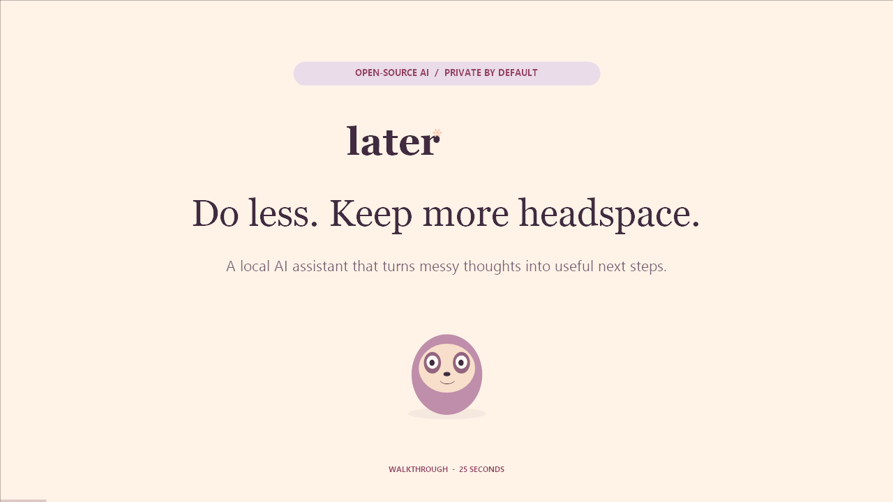
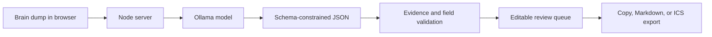

# Later ✳

> A private local AI that turns a messy brain dump into editable replies, checklists, and calendar reminders.

Later was created for DEV's **Slow and Steady** theme: software that does the first bit of work so you can conserve your energy. It runs an open-weight language model through Ollama and keeps the review step in human hands.

## 25-second walkthrough

[](https://github.com/swapnil-coder5/Later/blob/main/walkthrough-assets/Later-Walkthrough.mp4)

[Watch the full HD walkthrough video](https://github.com/swapnil-coder5/Later/blob/main/walkthrough-assets/Later-Walkthrough.mp4). It demonstrates Hinglish input, energy-based generation, prepared drafts, **Off your plate**, and the local Ollama architecture.

## Highlights

- Turns unstructured notes into useful drafts instead of another task list.
- Requires every generated task to cite an exact quote from the original note.
- Prepares replies, concrete checklists, and portable `.ics` calendar reminders.
- Sorts work by estimated preparation effort and highlights tasks that fit your energy.
- Includes five clearly labeled sample workflows for an instant demo.
- Stores tasks, drafts, profile settings, and completion history in browser local storage.
- Uses no frontend framework, database, paid inference API, or runtime npm dependency.
- Never sends a message or changes a calendar automatically.

## Demo without a model

```bash
npm start
```

Open [http://localhost:4173](http://localhost:4173), choose **Try 5 examples**, and press **Take this off my mind**. Sample results are prewritten and labeled as samples.

## Run with local AI

### Requirements

- [Node.js 22 or newer](https://nodejs.org/)
- [Ollama](https://ollama.com/)
- An Ollama text model such as `qwen3:4b`

```bash
ollama pull qwen3:4b
npm start
```

Keep Ollama running. Later discovers installed models automatically. The model download requires internet; inference can run offline afterward. Model speed and memory use depend on the model and hardware.

## How it works



The model receives a strict JSON Schema. The server then validates types, dates, allowed task kinds, effort ranges, and the exact source quotation before returning anything to the browser. Invalid model output is rejected rather than silently accepted.

| Area | Responsibility |
| --- | --- |
| `server.mjs` | Local HTTP boundary, Ollama requests, input limits, and security headers |
| `core.mjs` | Output schema, model-result validation, and RFC 5545 calendar generation |
| `public/` | Responsive interface, local persistence, profile settings, and exports |
| `test/` | Validation and calendar security tests |

## Privacy and security

- Later binds only to `127.0.0.1` and accepts only local hostnames and same-origin browser requests.
- Ollama defaults to `127.0.0.1:11434`, keeping inference on the same device.
- Notes are not logged by this application or forwarded to a third-party inference provider.
- Model output is inserted as text rather than HTML.
- Profile pictures are resized in the browser before local storage.

Browser local storage is unencrypted and shared with anyone using the same browser profile. Use a separate browser profile for sensitive notes. Read [SECURITY.md](SECURITY.md) before reporting a vulnerability.

## Verification

```bash
npm run check
```

The suite covers invented source evidence, invalid task fields and dates, empty plans, calendar-property injection, and UTF-8 line folding. Automated tests verify contracts and serialization, not model accuracy.

## Known limitations

- Every AI draft still needs human review.
- Exact quotation proves provenance, not semantic correctness.
- Small local models can occasionally fail the output contract; retrying may be necessary.
- Preparation minutes are estimates, not measured time saved.
- Text import supports `.txt` and `.md`; it does not parse PDFs or images.
- Later does not crawl files, read an inbox, run in the background, or take external actions.

## Contributing

Issues and pull requests are welcome. See [CONTRIBUTING.md](CONTRIBUTING.md) for the local workflow and project boundaries.

## License

[MIT](LICENSE) © 2026 Later contributors.

For a demo script, résumé bullet, and editable launch post, see [SHOWCASE.md](SHOWCASE.md).
